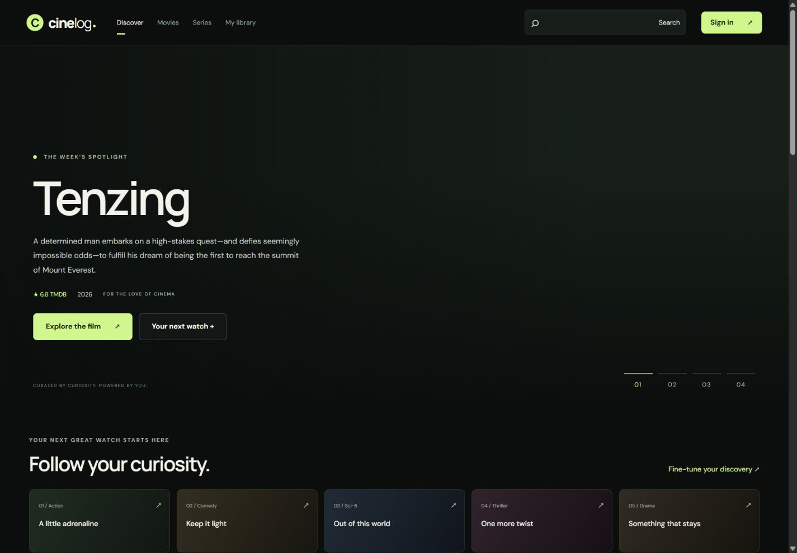
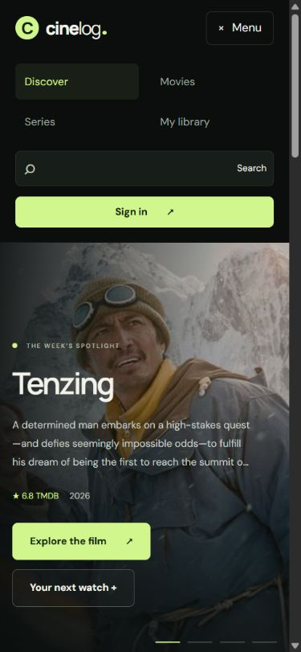

# CineLog interface review - 17 October 2026

## Changes

- Responsive disclosure menu for navigation, search and account access. Escape and outside clicks close it; route changes collapse it. Desktop navigation remains visible. Added a skip-to-content link.
- Removed page-wide overflow at its source, including absolutely positioned status text escaping poster shelves. Genre shortcuts wrap on mobile; intentional film/series/cast shelves retain contained horizontal scrolling. Narrow grids, forms, buttons and long titles adapt to available width.
- Added a small branded SVG favicon, route-specific document titles/descriptions and Open Graph text, title/person metadata, and noindex on private/search/error routes. Copyright year is generated at runtime.
- Footer links target real film, series, search and library routes. Header, footer, authentication and admin branding link home. Removed the unused legacy admin sidebar. Added a custom 404 with discovery/search recovery, including an admin catch-all.
- Replaced inert profile statistic buttons with static statistic panels. Repaired a dormant carousel watchlist button. Kept form labels while removing filler placeholders, and added password guidance.
- Added announced success feedback for library changes, ratings and reviews, poster-save announcements, and clear connection/timeout feedback. Episodes and people have retry/error states; genre-load failures are visible. Rejected sign-in requests keep their inline error instead of triggering an authentication redirect.
- Discovery year selection avoids partial invalid year requests. Pagination is integer-bounded to 1-500. Film/series sort keys are validated by media type. Empty searches clear loading state and invalid search types fall back to all results. Failed discovery requests no longer show a stale result count.
- Replaced original-resolution backdrop downloads with responsive 780/1280-pixel TMDB derivatives. Poster cards use responsive 185/342-pixel variants, lazy loading, async decoding and reserved dimensions. People use smaller portrait derivatives. Failed poster loads display a title fallback. Existing remote originals were not rewritten or downloaded; optimization occurs at delivery.
- Admin menu collapses on narrow screens, offers a close control/Escape, and preserves space for page content. Search toolbars wrap; wide management tables scroll inside their container.
- Kept the charcoal, ivory and restrained lime cinematic palette and refined interface copy consistently.

## Verification

- Frontend production build: passed.
- Frontend and backend lint: passed.
- API regression suite: 17 passing tests, with mocked database operations. Includes new fractional-page, incompatible-sort and malformed-filter cases.
- Homepage measured at 320, 390, 768, 1024 and 1440 viewport widths: document width matched viewport content width at every size. No page-wide horizontal overflow.
- Movie details, series details, filtered discovery, search, signed-out profile/library, sign-in and registration checked at narrow widths. Movie/series cast shelves remained independently scrollable.
- Menu open/close, Escape, automatic close on navigation, clickable home logo, footer search, custom 404 and route metadata checked in the browser.
- Film filter combination (Hindi, 2009, rating 8+) returned 3 Idiots. Series filters (English, 2008, rating 8+, newest release) returned matching titles. Reset restored the catalogue. A transient upstream TMDB error exercised the visible error state.
- Search for Breaking Bad with the Series filter opened its detail page. Season 1 loaded all seven episode titles. Streaming region control was exercised.
- Rendered home/detail links contained no empty destinations or unrecognized local route patterns. Home requested no original-resolution images. Footer displayed 2026 and the SVG favicon reference was present.
- Final browser console inspection returned no errors/warnings.

## Limits

This pass did not create accounts, modify live user data, upload images or run the previously blocked database migration. Signed-in mutation feedback and admin layouts were reviewed in source; a complete authenticated browser acceptance pass still needs a test account/environment. Third-party links and catalogue availability can change. Metadata updates in this client-rendered app require JavaScript; server rendering or prerendering is still needed for reliable rich previews in crawlers that do not execute JavaScript. The static host must retain SPA route fallback configuration. No deployment or production-readiness certification is implied.

Preview servers were stopped after verification.

