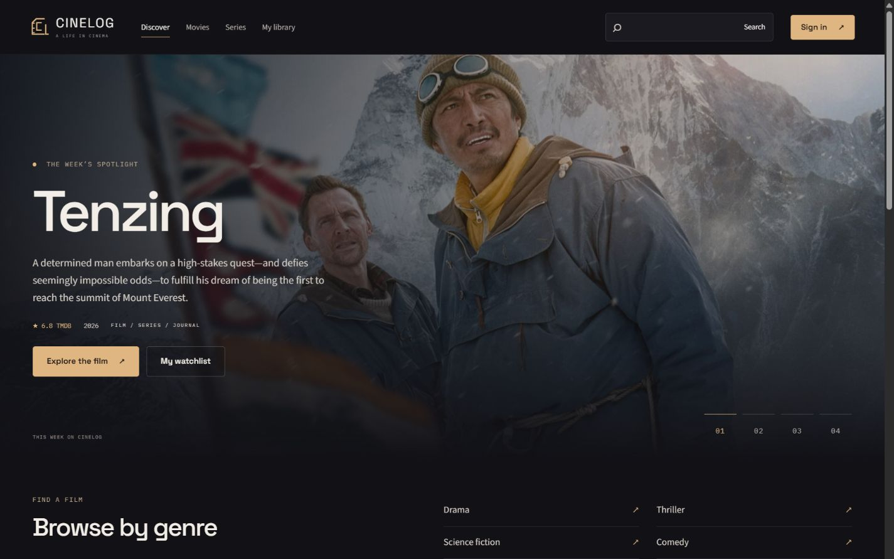
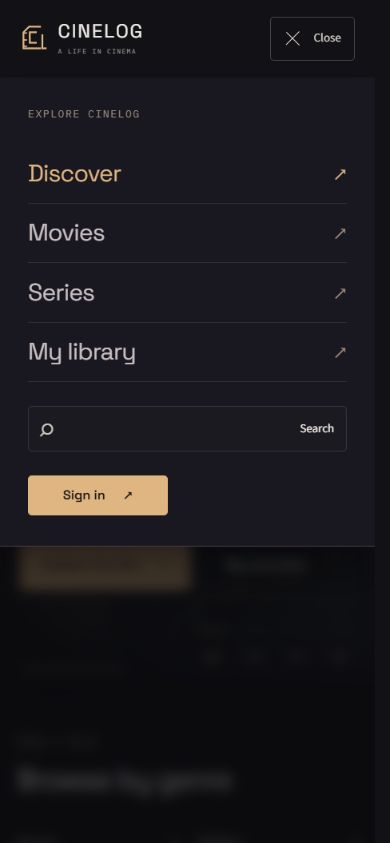

# CineLog visual identity - 17 October 2026

## Direction
Ink (#111116), warm ivory (#f2eee7), muted brass (#dfb582) and restrained plum surfaces replace the green palette. Space Grotesk is used for headings and branding; Source Sans 3 for interface/body text; IBM Plex Mono for compact metadata and section labels. Public pages and retained admin interfaces share the palette.

A custom SVG film-frame CL monogram and wordmark replace the circle-C logo across navigation, footer, authentication and admin. The favicon uses the same mark.

The previous mood-card section is replaced by a compact genre index. Copy is shorter and more descriptive. Movie/series catalogue pages no longer repeat the navigation switch.

The mobile menu is now an animated overlay with a backdrop, scrolling within short viewports, Escape dismissal, keyboard focus containment and focus restoration to content on navigation. It does not push the page content down. Buttons, links, poster cards and popup controls share restrained transition timings; reduced-motion preferences disable these effects.

The public dropdown is a select-only ARIA combobox with a listbox, pointer selection, arrows, Home/End, type-ahead, Enter/Space, Escape cancellation, Tab dismissal and outside-click dismissal. It positions upward when space below is limited and scrolls its own option list. Admin controls retain Ant Design motion and receive the matching theme.

## Verification
- Frontend lint and production build pass.
- Browser checked the new identity, menu open/close and Escape, direct Movies/Series navigation, and absence of the duplicate catalogue switch.
- Combined pointer and keyboard filter input selected Hindi, 2009 and 8+ and returned 3 Idiots. Escape canceled a pending genre choice.
- Series page width matched the viewport at 320, 390, 768, 1024 and 1440 pixels. Desktop home also had no horizontal overflow.
- Verified computed body/heading fonts and ink background. Final preview console returned no errors or warnings.
- No live user records were changed. Authenticated admin and library flows were reviewed in source rather than exercised with a live test account.
- Development servers remain running as requested.

